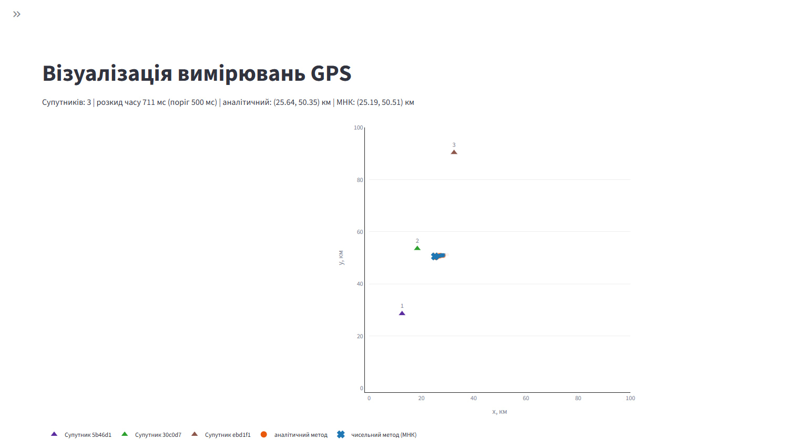
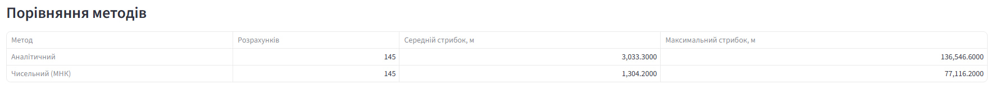

# Лабораторно-практичне заняття №3. Розробка додатку для візуалізації вимірювань GPS

## Опис роботи

Застосунок підключається до емульованої вимірювальної частини GPS (Docker image `iperekrestov/university:gps-emulation-service-2026`) через WebSocket, розраховує положення об'єкта за відстанями до трьох супутників **двома методами** та показує супутники й обидва результати на одному графіку (осі 0–100 км).

- **Відстань** до супутника: `R = 300 · (receivedAt − sentAt)` км (час у мс, `c ≈ 300 км/мс`).
- **Аналітичний метод:** пряме розв'язання системи рівнянь кіл за формулами `A…F`. Якщо супутники майже на одній прямій (знаменник близький до нуля), розрахунок пропускається.
- **Чисельний метод:** мінімізація `L(x, y) = Σ((x − xᵢ)² + (y − yᵢ)² − rᵢ²)²` (метод найменших квадратів) функцією `scipy.optimize.least_squares`. Початкове наближення: аналітичний розв'язок, а якщо його немає, то попереднє знайдене положення.
- **Додатково реалізовано:** слід руху об'єкта, що поступово згасає, та кількісне порівняння методів (середній і максимальний «стрибок» положення).

### Обраний варіант реалізації

**Варіант 5: «Все в одному» на Python (Streamlit).** Дані з WebSocket приймає клієнт `websocket-client` у фоновому потоці й записує в спільне потокобезпечне сховище; Streamlit раз на 0,5 с зчитує його, будує графік Plotly і таблицю порівняння. Чисельний розрахунок виконує `scipy`.

### Структура проєкту

| Файл | Призначення |
|---|---|
| `app.py` | інтерфейс Streamlit |
| `gps/config.py` | константи (адреса, `c`, поріг, межі зони) |
| `gps/receiver.py` | WebSocket-клієнт у фоновому потоці |
| `gps/store.py` | збереження вимірювань, відстані, перевірка розкиду, виклик розрахунків |
| `gps/trilateration.py` | аналітичний і чисельний методи |
| `gps/stats.py` | порівняння методів |
| `gps/plot.py` | графік Plotly |

## Запуск

**Потрібно:** Docker, Python 3.10+.

1. Запустіть емулятор (окремий термінал):

   ```bash
   docker pull iperekrestov/university:gps-emulation-service-2026
   docker run --rm --name gps-emulator -p 21701:4000 iperekrestov/university:gps-emulation-service-2026
   ```

   Перевірка: `http://localhost:21701/config` має показати параметри емулятора.

2. У папці проєкту створіть віртуальне середовище й встановіть залежності:

   ```bash
   python -m venv .venv
   .venv\Scripts\activate        # Linux/macOS: source .venv/bin/activate
   pip install -r requirements.txt
   ```

3. Запустіть застосунок:

   ```bash
   streamlit run app.py
   ```

   Сторінка відкриється на `http://localhost:8501`. Поріг розкиду, слід і скидання історії налаштовуються у бічній панелі.

4. Зупинка: `Ctrl+C`, потім `docker stop gps-emulator`.

## Обґрунтування порогу розкиду часу

Три відстані вимірюються в різні моменти, а об'єкт за цей час рухається. Розрахунок виконується, лише якщо різниця між найпізнішим і найранішим `receivedAt` серед трьох останніх вимірювань не перевищує порогу.

Поріг обрано так, щоб зміщення об'єкта за цей час не перевищувало похибки самих вимірювань (≈ 100 м, σ ≈ 90 м): тоді застарілість даних не вносить помітного додаткового викривлення.

- Швидкість об'єкта (з `/config` емулятора): `v = 0,05 км/с (180 км/год).` 
- Зміщення за час розкиду Δt: `s = v · Δt`.
- Вимога: `s ≲ 0,1 км`, тобто `Δt ≲ 0,1 / v`.
- Для `Δt = 1200 мс мс` маємо `s = 60 м`, що менше від похибки вимірювань.

**Обраний поріг: `500 мс`** (у коді за замовчуванням `MAX_SPREAD_MS = 1200`, змінюється повзунком в інтерфейсі). Занадто малий поріг призводить до частих пропусків розрахунків (лічильник «Пропущено розрахунків» під таблицею), занадто великий дає хибні положення через застарілі вимірювання.

## Результати

### Графік



### Порівняння методів



## Висновки

- Обидва методи дають близькі положення об'єкта: на графіку точки розташовані поруч.
- Виміряні відстані містять шум ≈ 100 м, тому положення «стрибає» від розрахунку до розрахунку. За таблицею аналітичний метод стрибає більше порівняно з чисельним.
- Аналітичний метод точний для ідеальних даних, але чутливий до шуму й нестійкий, коли супутники майже на одній прямій, тому такий випадок виявляється й пропускається. Чисельний метод використовує всі три відстані одночасно, але потребує доброго початкового наближення, тому старт береться з аналітичного розв'язку.
- Показник «стрибок» включає й реальний рух об'єкта, однаковий для обох методів, тож порівняння залишається коректним.